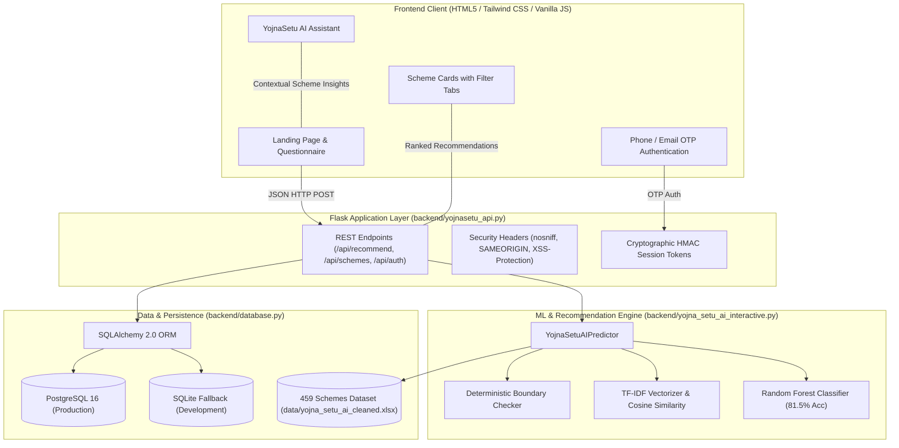
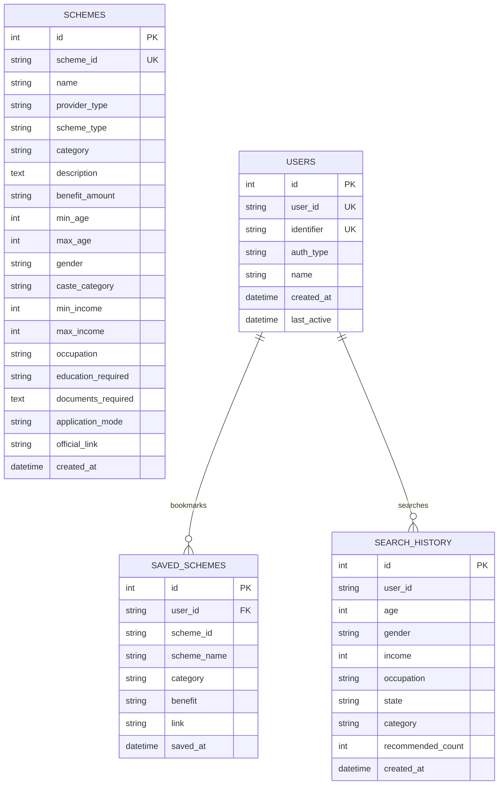

# 🇮🇳 YojnaSetu.ai – Scheme Finder That Finds You

[](https://www.python.org/downloads/)
[](https://flask.palletsprojects.com/)
[](https://scikit-learn.org/)
[](https://www.sqlalchemy.org/)
[](https://www.postgresql.org/)
[](tests/)
[](LICENSE)

**YojnaSetu.ai** is an intelligent, privacy-first civic-tech platform that connects Indian citizens with over 450+ Central, State, and Private welfare schemes. By combining a 6-step guided questionnaire with a hybrid Machine Learning recommendation engine (TF-IDF + Random Forest Classifier) and deterministic eligibility verification, YojnaSetu eliminates government bureaucracy and paperwork confusion—requiring no sensitive identity documents (such as Aadhaar or PAN) to explore matching benefits.

---

## 📑 Table of Contents

- [Key Features](#-key-features)
- [System Architecture](#-system-architecture)
- [Repository Structure](#-repository-structure)
- [Technology Stack](#-technology-stack)
- [Quick Start Guide](#-quick-start-guide)
  - [Prerequisites](#prerequisites)
  - [Local Installation](#local-installation)
  - [Running the Server](#running-the-server)
- [Docker & PostgreSQL Deployment](#-docker--postgresql-deployment)
- [REST API Reference](#-rest-api-reference)
- [Machine Learning & Scoring Pipeline](#-machine-learning--scoring-pipeline)
- [Database Schema](#-database-schema)
- [Automated Testing & Validation](#-automated-testing--validation)
- [Environment Configuration](#-environment-configuration)
- [Contributing & License](#-contributing--license)

---

## 🌟 Key Features

- **Personalized Multi-Criteria Matching**: Evaluates age brackets, gender, annual income, social category (General, OBC, SC, ST, EWS, Minority), state of residence, and occupation across 459 curated government welfare schemes.
- **Hybrid AI & ML Scoring**: Combines hard boundary eligibility checks (age/income/state) with TF-IDF cosine similarity and Random Forest categorization to produce composite match scores (40–99/100).
- **Comprehensive Scheme Metadata**: Returns detailed scheme descriptions, benefit amounts, required document checklists, application links, and transparent "Score Breakdown" reasons.
- **Multilingual Support**: Header language selector supporting 13 official Indian languages (English, Hindi, Marathi, Gujarati, Tamil, Telugu, Kannada, Malayalam, Bengali, Punjabi, Odia, Assamese, Urdu).
- **Authentication & Secure Bookmarking**: OTP verification (phone and email) with HMAC-signed session tokens and persistent bookmarking of favorite schemes.
- **Dual Database Flexibility**: Native PostgreSQL support for production deployments, with zero-configuration fallback to SQLite for local development.
- **Integrated AI Assistant**: In-app conversational assistant explaining benefits, eligibility, and step-by-step application procedures for any matched scheme.
- **Production-Ready**: Includes Waitress WSGI runner, Docker multi-stage containerization, Docker Compose with PostgreSQL 16 Alpine, and a 17-test Pytest suite.

---

## 🏛 System Architecture



---

## 📂 Repository Structure

```
yojnasetu/
├── backend/
│   ├── database.py                   # SQLAlchemy 2.0 ORM, models, and auto-seeder
│   ├── yojna_setu_ai_interactive.py   # Hybrid scheme recommender & eligibility engine
│   └── yojnasetu_api.py              # Flask REST API, security headers, auth, static server
├── data/
│   ├── yojna_setu_ai_cleaned.xlsx    # Master dataset of 459 government welfare schemes
│   └── yojnasetu.db                  # Local SQLite database (auto-generated when using SQLite)
├── frontend/
│   ├── index.html                    # Responsive single-page application template
│   ├── script.js                     # Dynamic questionnaire, API client, auth & chat assistant
│   └── styles.css                    # Custom CSS animations and government portal theme
├── ml/
│   ├── models/
│   │   └── yojna_setu_ai_ml_model.pkl# Pretrained ML artifacts (Random Forest + TF-IDF)
│   └── yojna_setu_ai_ml_model.py     # Training and evaluation pipeline for scheme classification
├── tests/
│   ├── test_api.py                   # Pytest suite for REST endpoints, auth, and security headers
│   ├── test_database.py              # Pytest suite for database models, queries, and bookmarks
│   └── test_recommender.py           # Pytest suite for eligibility rules, ML models, and scoring
├── utils/
│   ├── sqlite_viewer.py              # Interactive CLI browser for SQLite schemes
│   ├── validate_project.py           # Architectural health check and system validator
│   └── xlsx_to_sqlite.py             # Utility to export master Excel data to SQLite tables
├── .env.example                      # Environment variables template
├── .gitignore                        # Git ignore specifications
├── docker-compose.yml                # Docker Compose orchestration (PostgreSQL + YojnaSetu App)
├── Dockerfile                        # Multi-stage production container build
├── requirements.txt                  # Pinned Python package dependencies
├── wsgi.py                           # Production WSGI entry point (Waitress)
└── README.md                         # Project documentation
```

---

## 🛠 Technology Stack

| Layer | Technologies |
| :--- | :--- |
| **Frontend** | HTML5, Tailwind CSS, Vanilla JavaScript (ES6+), Google Translate API |
| **Backend Framework** | Python 3.11, Flask 3.1, Flask-CORS, Waitress WSGI Server |
| **Machine Learning** | Scikit-Learn 1.4 (`RandomForestClassifier`, `TF-IDF`), NumPy, Pandas |
| **Database & ORM** | PostgreSQL 16, SQLite 3, SQLAlchemy 2.0, `psycopg2-binary` |
| **Security** | HMAC-SHA256 Tokenization, HTTP Security Headers, Parameter Sanitization |
| **Testing** | Pytest 8.0, Pytest-Asyncio |
| **DevOps & Containers** | Docker, Docker Compose, Alpine Linux |

---

## 🚀 Quick Start Guide

### Prerequisites

- **Python**: Version 3.11 or higher
- **Git**: Installed on your system
- *(Optional)* **Docker & Docker Compose**: For containerized deployment

### Local Installation

1. **Clone the Repository**:
   ```bash
   git clone https://github.com/your-username/yojnasetu.git
   cd yojnasetu
   ```

2. **Create and Activate a Virtual Environment**:
   - **Windows (PowerShell)**:
     ```powershell
     python -m venv .venv
     .\.venv\Scripts\Activate.ps1
     ```
   - **Linux / macOS**:
     ```bash
     python3 -m venv .venv
     source .venv/bin/activate
     ```

3. **Install Dependencies**:
   ```bash
   pip install --upgrade pip
   pip install -r requirements.txt
   ```

4. **Initialize Configuration**:
   ```bash
   # Windows
   copy .env.example .env

   # Linux / macOS
   cp .env.example .env
   ```

### Running the Server

#### Development Mode:
```bash
python backend/yojnasetu_api.py
```

#### Production Mode (Waitress WSGI):
```bash
python wsgi.py
```

Once started, open **`http://localhost:5000`** in your browser. The Flask application automatically serves both the interactive frontend UI and the REST API.

---

## 🐳 Docker & PostgreSQL Deployment

To deploy YojnaSetu with a dedicated PostgreSQL database container:

1. **Start Services via Docker Compose**:
   ```bash
   docker compose up --build -d
   ```

2. **Verify Services**:
   ```bash
   docker compose ps
   ```

3. **Check Container Logs**:
   ```bash
   docker compose logs -f backend
   ```

4. **Access the Application**:
   Navigate to `http://localhost:5000`. Database records are persistently stored in the `pgdata` Docker volume.

5. **Stop Services**:
   ```bash
   docker compose down
   ```

---

## 📡 REST API Reference

### Health & Information

#### `GET /api/health`
Returns system status, database connectivity, and ML model availability.

**Response (HTTP 200)**:
```json
{
  "status": "ok",
  "database": "connected",
  "schemes_in_db": 459,
  "model_loaded": true,
  "dataset_schemes_cached": 459
}
```

---

### Scheme Recommendations

#### `POST /api/recommend`
Calculates personalized recommendations based on the citizen's profile.

**Request Body**:
```json
{
  "name": "Priya Sharma",
  "age": 22,
  "gender": "Female",
  "income": 80000,
  "occupation": "Student",
  "state": "UP",
  "category": "OBC",
  "preferred_categories": ["Education & Scholarships"],
  "limit": 10
}
```

**Response (HTTP 200)**:
```json
{
  "status": "success",
  "count": 10,
  "recommendations": [
    {
      "id": "SCHEME_042",
      "scheme": "UP Scholarship Scheme",
      "type": "state",
      "scheme_type_raw": "Uttar Pradesh",
      "category": "Education & Scholarships",
      "desc": "Financial scholarship for post-matric students belonging to reserved and minority groups",
      "benefit": "Tuition fee reimbursement up to ₹50,000",
      "score": 97.0,
      "link": "https://scholarship.up.gov.in/",
      "minAge": 16,
      "maxAge": 35,
      "gender": "All",
      "occupation": "Student",
      "caste": "SC,ST,OBC",
      "docs": ["Aadhaar Card", "Income Certificate", "Caste Certificate", "Marksheet"],
      "reasons": [
        "Meets basic eligibility criteria",
        "Tailored for Student",
        "Exclusive scheme for Uttar Pradesh",
        "Special affirmative benefits for OBC"
      ]
    }
  ]
}
```

---

### Scheme Catalog

#### `GET /api/schemes`
Paginated search across all schemes in the database.

- **Query Parameters**:
  - `page` *(default: 1)*: Page number
  - `limit` *(default: 20, max: 100)*: Items per page
  - `category` *(optional)*: Filter by category (e.g., `Education`)
  - `type` *(optional)*: Filter by type (`central`, `state`, `private`)
  - `search` *(optional)*: Keyword search across title and description

#### `GET /api/schemes/<scheme_id>`
Fetches complete details for a single scheme by ID.

---

### Authentication & Bookmarks

#### `POST /api/auth/send-otp`
Dispatches a 6-digit OTP to mobile or email.
```json
{
  "type": "phone",
  "identifier": "9876543210"
}
```

#### `POST /api/auth/verify-otp`
Validates the OTP and returns an HMAC session token.
```json
{
  "type": "phone",
  "identifier": "9876543210",
  "otp": "123456"
}
```

#### `GET /api/user/saved-schemes`
*(Requires `Authorization: Bearer <token>`)*  
Retrieves all bookmarked schemes for the authenticated user.

#### `POST /api/user/saved-schemes`
*(Requires `Authorization: Bearer <token>`)*  
Saves a scheme to the user's account.

#### `DELETE /api/user/saved-schemes/<scheme_id>`
*(Requires `Authorization: Bearer <token>`)*  
Removes a scheme from the user's bookmarks.

---

## 🧠 Machine Learning & Scoring Pipeline

The matching engine uses a hybrid rule-based and statistical approach:

1. **Hard Eligibility Filters**:
   - **Age Check**: User's age must fall between `Min Age` and `Max Age`.
   - **Gender Check**: If scheme specifies a gender, user's gender must match or be `All`.
   - **Income Check**: User's annual family income must be $\le \text{Max Income}$.
   - **State Check**: State-specific schemes only match residents of that state; Pan-India (`Central`) and `Private` schemes match all states.

2. **Composite Relevance Score (0 to 100)**:
   - **Base Passing Score**: $+30$ points.
   - **Age Proximity**: Up to $+15$ points based on distance from the target demographic midpoint.
   - **Income Bracket**: Up to $+15$ points, favoring low-income / BPL brackets when applicable.
   - **Occupation Match**: $+20$ points for exact or related employment matches (e.g. Farmer, Student, MSME vendor).
   - **State Match**: $+10$ points for state-specific welfare matches.
   - **Affirmative Action**: $+10$ points for caste/minority category benefits (OBC, SC, ST, EWS).
   - **Semantic Similarity**: Up to $+10$ points using cosine similarity between user preferences and scheme description TF-IDF vectors.

3. **Status Classification**:
   - $\text{Score} \ge 80 \implies$ **Likely Eligible** (Green Badge)
   - $60 \le \text{Score} < 80 \implies$ **Worth Checking** (Amber Badge)
   - $\text{Score} < 60 \implies$ **Check Eligibility** (Slate Badge)

---

## 🗄 Database Schema



---

## 🧪 Automated Testing & Validation

The project includes automated test coverage with **17 unit and integration tests** built with `pytest`:

```bash
# Run the test suite
pytest tests/ -v
```

### System Architecture Validation
Run the built-in system verification script to test all 12 core files, database seeding, ML inference, and API endpoints:

```bash
python utils/validate_project.py
```

Expected output:
```
=================================================================
YOJNASETU SYSTEM ARCHITECTURE VALIDATION
=================================================================

[1] CHECKING CORE DIRECTORIES & FILES...
   ✓ Frontend Template           : index.html
   ✓ Frontend Script             : script.js
   ✓ Frontend CSS                : styles.css
   ✓ Backend API                 : yojnasetu_api.py
   ✓ Interactive Predictor       : yojna_setu_ai_interactive.py
   ✓ SQLAlchemy Database Layer   : database.py
   ✓ ML Training Pipeline        : yojna_setu_ai_ml_model.py
   ✓ ML Model Artifact           : yojna_setu_ai_ml_model.pkl
   ✓ Cleaned Scheme Dataset      : yojna_setu_ai_cleaned.xlsx
   ✓ Production WSGI Entrypoint  : wsgi.py
   ✓ Dockerfile                  : Dockerfile
   ✓ Docker Compose Spec         : docker-compose.yml

[2] CHECKING DATABASE & SCHEMES REPOSITORY...
   ✓ Schemes Table Verified: 459 schemes loaded.

[3] CHECKING ML PREDICTOR & HYBRID MATCHING...
   ✓ ML Model & TF-IDF Vectorizer Loaded
   ✓ Cached Schemes in Memory: 459
   ✓ Recommendation Engine Active

[4] CHECKING REST API & STATIC SERVING...
   ✓ GET /api/health -> HTTP 200 OK
   ✓ GET / (UI Static Serve) -> HTTP 200 OK
   ✓ HTTP Security Headers Verified

=================================================================
ALL ARCHITECTURAL CHECKS PASSED - YOJNASETU IS HEALTHY & READY ✓
=================================================================
```

---

## ⚙️ Environment Configuration

Configuration variables can be defined in a `.env` file or exported to the system environment:

| Variable | Default Value | Description |
| :--- | :--- | :--- |
| `PORT` | `5000` | Port for the Flask and Waitress HTTP server |
| `HOST` | `0.0.0.0` | Bind host address |
| `ENV` | `development` | Environment mode (`development` or `production`) |
| `DATABASE_URL` | `sqlite:///data/yojnasetu.db` | PostgreSQL connection string or SQLite path |
| `SECRET_KEY` | *(Secure default provided)* | Secret key used for signing session HMAC tokens |
| `CORS_ORIGINS` | `*` | Allowed CORS origins for API requests |
| `MODEL_PATH` | `ml/models/yojna_setu_ai_ml_model.pkl` | *(Optional)* Custom path to pickled ML artifact |
| `DATASET_PATH` | `data/yojna_setu_ai_cleaned.xlsx` | *(Optional)* Custom path to master schemes Excel file |

---

## 📜 Contributing & License

1. Fork this repository.
2. Create a descriptive feature branch (`git checkout -b feature/new-scheme-feed`).
3. Commit your changes (`git commit -m 'Add state scheme feed integration'`).
4. Ensure all Pytest tests pass (`pytest tests/`).
5. Push to your branch and open a Pull Request.

Distributed under the **MIT License**. See `LICENSE` for further details.
